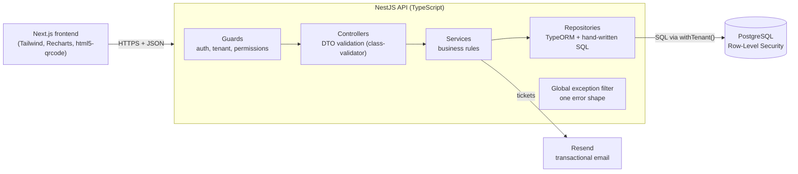
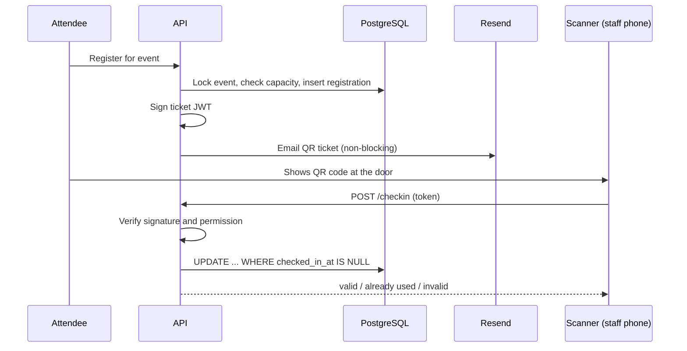

# Campus Pass

> **Working title.** The name is a placeholder and will be renamed.

A multi-tenant SaaS for running club and community events: create a workspace, organise it into clubs, publish events, email signed QR tickets, scan people in at the door from a phone, and see how each event performed.

Built as a full-stack learning and portfolio project to demonstrate **multi-tenant data isolation, a custom role and permission system, signed tokens, concurrency-safe check-in, and analytics**.

> **Status: planning complete, build in progress.** This README describes what is being built. Sections marked *(planned)* are not implemented yet.

---

## What it does

1. **Create a workspace.** A university, company, church group, or local meetup signs up and gets its own isolated space (for example `/o/state-uni`).
2. **Add clubs.** A workspace contains one or more clubs (Coding Club, Robotics Club). Small groups get one default club and never have to think about clubs.
3. **Invite members.** People join a club through an **invite link**. Links can expire, have a use limit, assign a default role, and optionally require **approval** before the person is let in.
4. **Publish events.** Organisers create and publish events with a capacity limit. Events are either members-only or public.
5. **Register and get a ticket.** Registering generates a cryptographically signed pass, encoded as a QR code and emailed to the attendee. Public events also accept guests (name and email only).
6. **Scan at the door.** Staff open a mobile scanner page, point the camera at a QR code, and attendance is recorded instantly. A ticket can never be used twice.
7. **See the results.** A dashboard shows registrations over time, registered-to-attended conversion, peak arrival times, and attendance percentage. Workspace owners also get a rollup across all their clubs.

---

## Core concepts

### Two-level tenancy: workspace → clubs

| Level | Example | Purpose |
|---|---|---|
| **Workspace** (organisation) | State University | The **tenant**. Hard data-isolation boundary. |
| **Club** | Coding Club | A unit inside a workspace with its own members, roles, and events. |

A person can belong to many workspaces and many clubs, and can hold different roles in each.

### Joining

- **Clubs are joined by invite link.** Links support expiry, max uses, a default role, and a "requires approval" flag.
- **Approval:** when a link requires approval, joining creates a *pending request*. Anyone with the right permission can approve or reject it, and the decision (who, when) is recorded.
- **Workspace join policy** is configurable: invite link (default) or open. Restricting joins to an email domain (for example `@stateuni.edu`) is a later stretch feature.
- **Public events** do not require membership. Guests can register with just a name and email.

### Roles and permissions (Discord-style)

Permissions are a fixed list defined in code. Roles are built by each club out of those permissions, and a member can hold several roles (permissions combine).

| Permission | Allows |
|---|---|
| `event.create`, `event.publish` | Create and publish events |
| `event.manage_own` / `event.manage_any` | Edit your own events / anyone's events |
| `registration.view` | See the attendee list |
| `checkin.scan` | Use the scanner |
| `analytics.view` | See the dashboard |
| `member.approve` | Approve or reject join requests |
| `member.remove` | Remove members |
| `invite.manage` | Create and revoke invite links |
| `role.manage` | Create and edit roles |

Every club starts with default roles that owners can edit or extend:

| | Owner | Admin | Organizer | Scanner | Member |
|---|:-:|:-:|:-:|:-:|:-:|
| Create and publish own events | ✅ | ✅ | ✅ | | |
| Edit or delete anyone's events | ✅ | ✅ | | | |
| View attendee list and analytics | ✅ | ✅ | ✅ | | |
| Scan tickets | ✅ | ✅ | ✅ | ✅ | |
| Approve join requests, manage invites | ✅ | ✅ | | | |
| Manage roles and remove members | ✅ | ✅* | | | |
| Delete club / transfer ownership | ✅ | | | | |

\* only for roles and people **below** their own position.

**Role hierarchy.** Roles have a position. You can only create, edit, or assign roles below your own, and the Owner role cannot be removed or demoted. This prevents privilege escalation.

**Organisers publish events directly.** There is no event-approval step. Approval applies to joining only.

---

## Architecture



### Multi-tenancy: shared schema with Row-Level Security

All tenants share one database and one set of tables. Every tenant-owned row carries an `org_id`, and **PostgreSQL itself** enforces isolation:

1. The app connects as a limited database role (not the table owner).
2. RLS is **enabled and forced** on every tenant-scoped table, with a policy like *"a row is visible only if its `org_id` equals the current organisation."*
3. For each request, `withTenant()` opens a transaction (a TypeORM `QueryRunner`) and runs `SET LOCAL app.current_org_id = ...` so the setting cannot leak between pooled connections. Every tenant-scoped query runs through that transaction's manager.
4. Policies include `WITH CHECK`, so a write can never target another organisation.

**Two layers of protection:** guards check membership in the app, and RLS enforces it in the database. If application code forgets a `WHERE org_id = ...`, the database still returns only the current tenant's rows.

**Finding the tenant first.** Some requests only carry a public identifier (`/o/:slug`, `/join/:code`, a ticket's event id), and under RLS the app cannot look anything up before it knows the org. A handful of `SECURITY DEFINER` database functions (`org_id_for_slug`, `org_id_for_club`, `org_id_for_event`, `org_id_for_invite_code`) answer only "which org is this?" and return an id, never tenant data. `user_organisations(user_id)` lists a user's own workspaces, the one query that is cross-tenant by nature.

Why this approach: clubs are many and small, one migration updates everyone, and cross-club features (a student in several clubs, a workspace-wide rollup) stay simple queries.

### Signed tickets

- On registration the backend signs a **small JWT** containing only the registration id, event id, and an expiry. Everything else is looked up in the database.
- The token is encoded as a QR code (`qrcode`) and emailed through Resend.
- Tickets use a **separate signing secret** from login tokens.
- A valid signature proves a ticket is *genuine*, not that it is *unused*, so check-in also does an atomic database update (below).

### Concurrency-safe operations

| Problem | Solution |
|---|---|
| Two people grab the last seat | Capacity checked inside a transaction with a row lock (`SELECT ... FOR UPDATE`) |
| A ticket scanned twice, or by two scanners at once | `UPDATE registrations SET checked_in_at = now() WHERE id = $1 AND checked_in_at IS NULL`. Zero rows updated means already used. |
| Invite with 1 use joined by two people at once | Atomic use counting |

### Registration to check-in flow



---

## Data model

```
users
organisations ─┬─< org_members >─ users
               └─< clubs ─┬─< club_members >─ users
                          ├─< roles ─< member_roles
                          ├─< invites ─< join_requests >─ users
                          └─< events ─< registrations >─ users
```

| Table | Purpose |
|---|---|
| `users` | Everyone who signs up, including lightweight guest accounts |
| `organisations` | The workspace (tenant), with join policy |
| `org_members` | Which users belong to which workspace |
| `clubs` | Clubs inside a workspace |
| `club_members` | Which users belong to which club |
| `roles` | Custom roles per club, holding a list of permissions and a position |
| `member_roles` | Which roles each member holds |
| `invites` | Invite links with expiry, max uses, default role, approval flag |
| `join_requests` | Pending, approved, or rejected join requests |
| `events` | Events created by a club |
| `registrations` | A user's sign-up for an event, including `checked_in_at` |

Permissions are a fixed list in code, tickets are generated from registrations rather than stored, and analytics are computed by SQL queries rather than saved.

### How the database layer is used

TypeORM provides the connection pool, transactions, entities for simple CRUD, and migrations. The parts this project exists to demonstrate are written as **plain SQL** so the mechanics stay visible:

- RLS policies, `FORCE ROW LEVEL SECURITY`, and database roles live in migrations written by hand.
- Capacity checks (`SELECT ... FOR UPDATE`), atomic check-in, and atomic invite use counting are raw queries inside a transaction.
- Analytics are SQL aggregate queries.

`synchronize` is never used to build the schema: it knows nothing about RLS policies or database roles.

---

## Tech stack

| Layer | Choice |
|---|---|
| Frontend | Next.js (server and client components), Tailwind CSS, Recharts |
| Scanner | `html5-qrcode` (camera access requires HTTPS) |
| Backend | Node.js 22, NestJS, TypeScript, class-validator |
| Database | PostgreSQL with Row-Level Security |
| Data access | TypeORM (pool, transactions, migrations) + hand-written SQL for RLS, locking, and analytics |
| Auth | bcrypt password hashing, JWT sessions |
| Tickets | JWT signature, `qrcode` library |
| Email | Resend (transactional) |
| Testing | Vitest, Supertest |
| Package manager | pnpm |
| DevOps | Docker, Docker Compose, GitHub Actions |

### Backend layout

```
backend/src/
├── main.ts
├── app.module.ts
├── config/                env loading and validation
├── common/
│   ├── errors/            HttpError
│   ├── filters/           global exception filter (one error response shape)
│   ├── guards/            (planned) auth, tenant, @RequirePermission()
│   └── decorators/        (planned) @CurrentUser(), @CurrentOrg()
├── database/
│   ├── database.module.ts TypeORM connection (as the limited app role)
│   ├── data-source.ts     TypeORM CLI connection (as the schema owner)
│   ├── migrations/        schema, RLS policies, database roles, tenant lookups
│   └── tenant.service.ts  withTenant() and tenant resolution
└── modules/
    ├── user/              users (scaffolded)
    ├── auth/              (planned) register, login, me
    ├── workspaces/        (planned) workspaces and clubs
    ├── permissions/       (planned) roles, hierarchy, permission checks
    ├── invites/           (planned) invite links, join requests, approval
    ├── events/            (planned) events and visibility
    ├── registrations/     (planned) sign-up and capacity protection
    ├── passes/            (planned) ticket signing, QR generation
    ├── checkin/           (planned) scanner endpoint, atomic attendance
    ├── analytics/         (planned) dashboard queries
    └── email/             (planned) Resend client and ticket template
```

Each module is a Nest module with its own controller, service, entities, and DTOs, so a feature can be read top to bottom in one folder. Unit tests sit next to the code (`*.spec.ts`); end-to-end tests live in `backend/test/`.

### Errors

Every error is returned in one shape by a global exception filter:

```json
{ "statusCode": 404, "code": "USER_NOT_FOUND", "message": "User #9 not found", "path": "/user/9", "timestamp": "..." }
```

Code throws `HttpError` (for example `HttpError.notFound(..., 'USER_NOT_FOUND')`). Nest exceptions and Postgres errors (unique violation → 409, foreign key → 409, invalid input → 400) are mapped to the same shape, and unknown errors become a generic 500 with the stack trace logged server-side only.

---

## Security

- Passwords hashed with bcrypt; login errors never reveal whether an email exists.
- Tenant isolation enforced in the database with forced RLS, not only in application code.
- Every query uses parameters (no SQL injection); input validated at the edge with DTOs and class-validator.
- Errors never leak internals: unknown errors return a generic 500 and are logged server-side.
- Permission checks on every route; role hierarchy prevents privilege escalation.
- Invite codes come from cryptographically secure random bytes.
- Tickets are signed with a dedicated secret; tampered, expired, or wrong-event tickets are rejected.
- Rate limiting on auth routes, security headers (helmet), restricted CORS, request size limits.

---

## Testing

The tests that matter most are the ones that prove the hard claims:

- **Tenant isolation:** org A cannot read or write org B's data, even with an unfiltered query.
- **Permissions:** missing permission returns 403, admins cannot grant a role above their own, the owner cannot be demoted.
- **Invites:** expired, revoked, and max-use links are rejected; the approval flow works end to end.
- **Overbooking:** many simultaneous registrations for the last seat produce exactly one success.
- **Tickets:** tampered, expired, and wrong-secret tokens are rejected.
- **Check-in:** scanning twice, or from two scanners at once, checks the person in exactly once.

---

## Getting started

Requires Docker. Node 22+ and pnpm are only needed to run things outside Docker.

```bash
# 1. configure the backend (also read by the db container)
cp backend/.env.example backend/.env    # then replace every change-me

# 2. start everything; the backend applies migrations before it starts
docker compose up --build
```

| Service | URL on your machine |
|---|---|
| Frontend | http://localhost:3000 |
| Backend API | http://localhost:5001 (port 5001 inside Docker) |
| API docs (Swagger) | http://localhost:5001/docs, OpenAPI JSON at `/docs-json` (off in production unless `SWAGGER_ENABLED=true`) |
| PostgreSQL | localhost:5432 |

The backend is published on **5001** because macOS uses port 5000 for AirPlay Receiver.

Running the backend directly on your machine instead: change the `DATABASE_URL` host to `localhost`, then `cd backend && pnpm install && pnpm start:dev`.

After adding packages to the backend, refresh the container's `node_modules` volume:

```bash
docker compose rm -sf backend && docker volume rm muster_backend_node_modules && docker compose up -d --build backend
```

Two database connections, both in `backend/.env`:

| Variable | Role | Used by |
|---|---|---|
| `DATABASE_URL` | `muster_app`: no superuser, no `BYPASSRLS`, data access only | the running app |
| `MIGRATION_DATABASE_URL` | the schema owner (`POSTGRES_USER`) | migrations only |

The first migration run creates `muster_app` with the password in `DATABASE_URL`.

Migrations (run inside the container, where the database host is `db`):

```bash
docker compose exec backend pnpm migration:run      # apply pending
docker compose exec backend pnpm migration:revert   # undo the last one
docker compose exec backend pnpm migration:show     # list applied / pending
docker compose exec backend pnpm migration:check    # fail if entities and schema differ
docker compose exec backend pnpm migration:generate src/database/migrations/AddSomething
```

Generated migrations are a starting point: review them, and add RLS for any new tenant table by hand.

Tests: `cd backend && pnpm test` (unit). End-to-end tests, including tenant isolation, need the database: `docker compose exec backend pnpm test:e2e`.

*(planned)* `pnpm seed` (two demo workspaces, clubs, roles, and events). `TICKET_SECRET` and `RESEND_API_KEY` will be added with tickets and email.

Notes: Resend only delivers to arbitrary addresses once you verify a sending domain, so use its test mode during development. The camera scanner needs HTTPS (`localhost` is allowed).

---

## Roadmap

Work is tracked in small tasks (30 to 90 minutes each), in this order:

| Phase | Focus |
|---|---|
| 1 | Foundation and tenancy: schema, RLS, `withTenant`, auth, workspaces, isolation tests |
| 2 | Roles, invites, and join approval |
| 3 | Events, registration, overbooking protection |
| 4 | Signed passes, QR codes, email |
| 5 | Check-in API and mobile scanner |
| 6 | Analytics dashboard |
| 7 | Next.js frontend |
| 8 | Polish, CI, documentation, deployment |
| 9 | **Later:** pricing plans |

### Planned later: pricing

The core product comes first. After it is complete, a `plan` column on `organisations` will drive three tiers (Free, Club Pro, Campus) with enforced limits (events per month, registrations per event, scanner staff, analytics access), plus a pricing page. Stripe test-mode billing is a stretch goal.

---

## Design trade-offs

- **Shared schema over schema-per-tenant:** cheapest to run and migrate, and safe because RLS is forced. Schema-per-tenant or database-per-tenant would isolate more strongly at much higher operational cost.
- **Polling over WebSockets** for the live attendance counter: simple, and plenty for this use.
- **Offset pagination and `ILIKE` search** are fine at this scale; keyset pagination and full-text search are the upgrade path.
- **NestJS over plain Express:** modules, dependency injection, and guards map directly onto the design (one module per feature, `@RequirePermission()` guards, request-scoped tenant context), at the cost of more framework conventions.
- **TypeORM, but SQL where it matters:** the ORM handles plumbing and simple CRUD; RLS, locking, atomic updates, and analytics are hand-written SQL so the important mechanics are visible and not hidden behind ORM abstractions.
- **Migrations written by hand** (run through TypeORM's migration runner) instead of auto-generated schema, because RLS policies and database roles cannot be expressed in entities.

---

## License

To be decided.