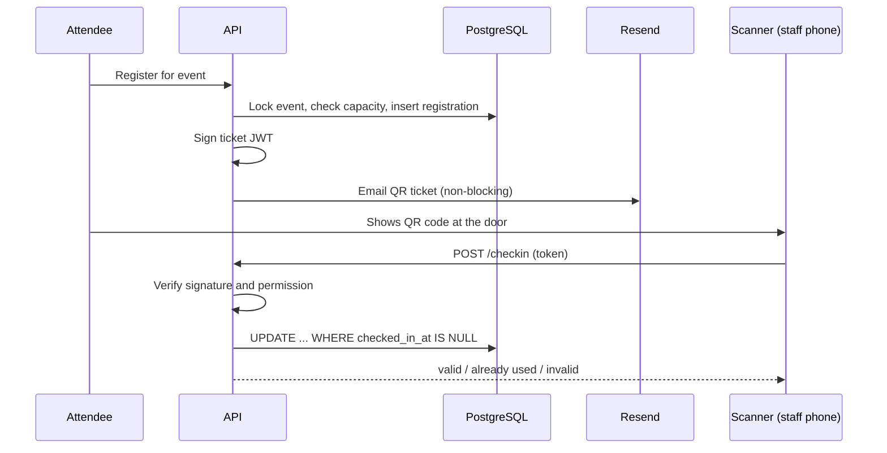

# Muster

A multi-tenant SaaS for running club and community events: create a workspace, organise it into clubs, publish events, email signed QR tickets, scan people in at the door from a phone, and see how each event performed.

Built as a full-stack learning and portfolio project to demonstrate **multi-tenant data isolation, a custom role and permission system, signed tokens, concurrency-safe check-in, and analytics**.

> **Status: built and deployed.** Phases 1 to 8 of the [roadmap](#roadmap) are done; pricing plans come next.

---

## What it does

1. **Create a workspace.** A university, company, church group, or local meetup signs up and gets its own isolated space (for example `/o/state-uni`).
2. **Add clubs.** A workspace contains one or more clubs (Coding Club, Robotics Club). Small groups get one default club and never have to think about clubs.
3. **Bring people in.** Each club decides who can join it: anyone in the workspace (from **Browse clubs**), people who **ask** (its approvers decide), or **invite links** only. Invite links can expire, have a use limit, give a role, and require approval; each club also has a plain link to share, `/c/{workspace}/{club}`.
4. **Publish events.** Organisers create events (one-off or repeating) with a capacity, ticket types and prices, discount codes, a cover image, and questions to ask. Events are members-only or public.
5. **Register and get a ticket.** Registering (or buying: through the workspace's own Stripe account, or paid to its organisers directly, with eSewa, Khalti, a bank transfer or cash, where Stripe isn't available) gives a cryptographically signed pass, shown as a QR code and emailed. Full events have a waitlist; public events also take guests (name and email only).
6. **Scan at the door.** Staff open a scanner on their phone and point the camera at a QR code, or check people in by name. A ticket can never be used twice, and the door keeps working with no connection.
7. **See the results.** Attendance per event and per month, what people answered, how they rated it afterwards, and an activity log of who changed what.
8. **Find anything.** Search (⌘K) finds clubs, events, people and the app's own pages across every workspace you're in.

---

## Core concepts

### Two-level tenancy: workspace → clubs

| Level | Example | Purpose |
|---|---|---|
| **Workspace** (organisation) | State University | The **tenant**. Hard data-isolation boundary. |
| **Club** | Coding Club | A unit inside a workspace with its own members, roles, and events. |

A person can belong to many workspaces and many clubs, and can hold different roles in each.

### Joining

- **The workspace** has its own join policy: invite links only (the default), people who ask (moderators decide), or open to anyone with the address. Joining it puts you in its default club, General.
- **Each club** has its own, set in its settings: invite links only (the default), **ask to join**, or **anyone in the workspace**. Clubs that take people without an invite show in Browse clubs.
- **Invite links** support expiry, max uses, a default role, and a "requires approval" flag. Opened by someone outside the workspace, a link brings them into the workspace too.
- **A club's own link** (`/c/{workspace}/{club}`) isn't secret, so it follows both settings: someone outside an open workspace joins it with the club; when the workspace asks, they ask it first.
- **Approval:** a request (from Browse clubs, a club link, or a link that requires approval) waits in the club's settings, under Join requests. Anyone with `member.approve` there decides, and the decision (who, when) is recorded.
- **Who sees whom:** a plain member sees the workspace's staff and the people they share a club with (General doesn't count), on the Members page and in search. Moderators and up see everyone. Open workspaces let anyone in, so nobody gets the whole list by joining.
- **Public events** do not require membership. Guests can register with just a name and email.

### Roles and permissions (Discord-style)

Permissions are a fixed list defined in code. Roles are built by each club out of those permissions, and a member can hold several roles (permissions combine).

| Permission | Allows |
|---|---|
| `event.create`, `event.publish` | Create and publish events |
| `event.manage_own` / `event.manage_any` | Edit your own events / anyone's events |
| `registration.view` | See the attendee list |
| `checkin.scan` | Use the scanner |
| `analytics.view` | See the dashboard |
| `member.approve` | Approve or reject join requests |
| `member.remove` | Remove members |
| `invite.manage` | Create and revoke invite links |
| `role.manage` | Create and edit roles |

Every club starts with default roles that owners can edit or extend:

| | Owner | Admin | Organizer | Scanner | Member |
|---|:-:|:-:|:-:|:-:|:-:|
| Create and publish own events | ✅ | ✅ | ✅ | | |
| Edit or delete anyone's events | ✅ | ✅ | | | |
| View attendee list and analytics | ✅ | ✅ | ✅ | | |
| Scan tickets | ✅ | ✅ | ✅ | ✅ | |
| Approve join requests, manage invites | ✅ | ✅ | | | |
| Manage roles and remove members | ✅ | ✅* | | | |
| Delete club / transfer ownership | ✅ | | | | |

\* only for roles and people **below** their own position.

**Role hierarchy.** Roles have a position. You can only create, edit, or assign roles below your own, and the Owner role cannot be removed or demoted. This prevents privilege escalation.

**Organisers publish events directly.** There is no event-approval step. Approval applies to joining only.

---

## Architecture


### Multi-tenancy: shared schema with Row-Level Security

All tenants share one database and one set of tables. Every tenant-owned row carries an `org_id`, and **PostgreSQL itself** enforces isolation:

1. The app connects as a limited database role (not the table owner).
2. RLS is **enabled and forced** on every tenant-scoped table, with a policy like *"a row is visible only if its `org_id` equals the current organisation."*
3. For each request, `withTenant()` opens a transaction (a TypeORM `QueryRunner`) and runs `SET LOCAL app.current_org_id = ...` so the setting cannot leak between pooled connections. Every tenant-scoped query runs through that transaction's manager.
4. Policies include `WITH CHECK`, so a write can never target another organisation.

**Two layers of protection:** guards check membership in the app, and RLS enforces it in the database. If application code forgets a `WHERE org_id = ...`, the database still returns only the current tenant's rows.

**Finding the tenant first.** Some requests only carry a public identifier (`/o/:slug`, `/join/:code`, a ticket's event id), and under RLS the app cannot look anything up before it knows the org. A handful of `SECURITY DEFINER` database functions (`org_id_for_slug`, `org_id_for_club`, `org_id_for_event`, `org_id_for_invite_code`) answer only "which org is this?" and return an id, never tenant data. `user_organisations(user_id)` lists a user's own workspaces, the one query that is cross-tenant by nature.

Why this approach: clubs are many and small, one migration updates everyone, and cross-club features (a student in several clubs, a workspace-wide rollup) stay simple queries.

### Signed tickets

- On registration the backend signs a **small JWT** containing only the registration id, event id, and an expiry. Everything else is looked up in the database.
- The token is encoded as a QR code (`qrcode`) and emailed through Resend.
- Tickets use a **separate signing secret** from login tokens.
- A valid signature proves a ticket is *genuine*, not that it is *unused*, so check-in also does an atomic database update (below).

### Concurrency-safe operations

| Problem | Solution |
|---|---|
| Two people grab the last seat | Capacity checked inside a transaction with a row lock (`SELECT ... FOR UPDATE`) |
| A ticket scanned twice, or by two scanners at once | `UPDATE registrations SET checked_in_at = now() WHERE id = $1 AND checked_in_at IS NULL`. Zero rows updated means already used. |
| Invite with 1 use joined by two people at once | Atomic use counting |

### Registration to check-in flow



---

## Data model

```
users
organisations ─┬─< org_members >─ users
               └─< clubs ─┬─< club_members >─ users
                          ├─< roles ─< member_roles
                          ├─< invites ─< join_requests >─ users
                          └─< events ─< registrations >─ users
```

| Table | Purpose |
|---|---|
| `users` | Everyone who signs up, including lightweight guest accounts |
| `organisations` | The workspace (tenant), with its join policy and time zone |
| `org_members` | Which users belong to which workspace |
| `clubs` | Clubs inside a workspace, each with its own join policy |
| `club_members` | Which users belong to which club |
| `roles` | Custom roles per club, holding a list of permissions and a position |
| `member_roles` | Which roles each member holds |
| `invites` | Invite links with expiry, max uses, default role, approval flag |
| `join_requests` | Requests to join a club (through a link that needs approval, or asked from Browse clubs), pending, approved, or rejected |
| `events` | Events created by a club |
| `registrations` | A user's sign-up for an event, including `checked_in_at` |

Permissions are a fixed list in code, tickets are generated from registrations rather than stored, and analytics are computed by SQL queries rather than saved.

### How the database layer is used

TypeORM provides the connection pool, transactions, entities for simple CRUD, and migrations. The parts this project exists to demonstrate are written as **plain SQL** so the mechanics stay visible:

- RLS policies, `FORCE ROW LEVEL SECURITY`, and database roles live in migrations written by hand.
- Capacity checks (`SELECT ... FOR UPDATE`), atomic check-in, and atomic invite use counting are raw queries inside a transaction.
- Analytics are SQL aggregate queries.

`synchronize` is never used to build the schema: it knows nothing about RLS policies or database roles.

---

## Tech stack

| Layer | Choice |
|---|---|
| Frontend | Next.js 16, Tailwind CSS, shadcn/ui (on Base UI), TanStack Query and Pacer, charts with shadcn Chart (Recharts) |
| Scanner | `html5-qrcode` (camera access requires HTTPS) |
| Backend | Node.js 22, NestJS, TypeScript, class-validator |
| Database | PostgreSQL with Row-Level Security |
| Data access | TypeORM (pool, transactions, migrations) + hand-written SQL for RLS, locking, and analytics |
| Auth | scrypt password hashing, short JWT access tokens, rotating refresh tokens |
| Tickets | JWT signature, `qrcode` library |
| Email | Resend (transactional) |
| Payments | Stripe Connect (each workspace's own account), or paid to the organisers directly; Muster never holds the money |
| Testing | Vitest, Supertest, Playwright |
| Package manager | pnpm |
| DevOps | Docker, Docker Compose, GitHub Actions |

### Backend layout

```
backend/src/
├── main.ts
├── app.module.ts
├── config/                env loading and validation
├── common/                HttpError, the exception filter, decorators, page cursors
├── database/
│   ├── database.module.ts TypeORM connection (as the limited app role)
│   ├── data-source.ts     TypeORM CLI connection (as the schema owner)
│   ├── migrations/        schema, RLS policies, database roles, tenant lookups
│   ├── migrate.ts         applies migrations at start-up, quietly
│   ├── seed.ts            the demo data
│   └── tenant.service.ts  withTenant() and tenant resolution
└── modules/
    ├── auth/              sign-up, verification, sessions, password reset
    ├── user/              accounts
    ├── organisation/      workspaces, their members and join requests, who sees whom
    ├── club/              clubs: settings, members, roles, ownership
    ├── permission/        the permission list, hierarchy, @RequirePermission()
    ├── invite/            invite links, club join requests, Browse clubs, club links
    ├── event/             events, series, ticket types, discount codes, questions, messages
    ├── registration/      places, guests, check-in, reminders
    ├── waitlist/          waitlists, places handed out in order
    ├── ticket/            signed tickets and their QR codes
    ├── payment/           Stripe Connect per workspace, direct payments, checkouts, refunds
    ├── analytics/         attendance
    ├── feedback/          the "how was it?" email and its answers
    ├── feed/              calendar feeds and new-event emails
    ├── notification/      who follows what
    ├── search/            ⌘K across workspaces
    ├── audit/             the activity log
    ├── files/             cover images
    └── email/             Resend client and templates
```

scripts/load-test.ts       builds a big workspace and times the lists (pnpm load-test)

Each module is a Nest module with its own controller, service, entities, and DTOs, so a feature can be read top to bottom in one folder. Unit tests sit next to the code (`*.spec.ts`); end-to-end tests live in `backend/test/`.

### Errors

Every error is returned in one shape by a global exception filter:

```json
{ "statusCode": 404, "code": "USER_NOT_FOUND", "message": "User #9 not found", "path": "/user/9", "timestamp": "..." }
```

Code throws `HttpError` (for example `HttpError.notFound(..., 'USER_NOT_FOUND')`). Nest exceptions and Postgres errors (unique violation → 409, foreign key → 409, invalid input → 400) are mapped to the same shape, and unknown errors become a generic 500 with the stack trace logged server-side only.

---

## Security

- Passwords hashed with scrypt; login errors never reveal whether an email exists.
- Tenant isolation enforced in the database with forced RLS, not only in application code.
- Every query uses parameters (no SQL injection); input validated at the edge with DTOs and class-validator.
- Errors never leak internals: unknown errors return a generic 500 and are logged server-side.
- Permission checks on every route; role hierarchy prevents privilege escalation.
- Invite codes come from cryptographically secure random bytes.
- Tickets are signed with a dedicated secret; tampered, expired, or wrong-event tickets are rejected.
- Rate limiting on auth and invite routes, per client (`TRUST_PROXY` makes that true behind a proxy), restricted CORS, request size limits.
- Production refuses to start with short or placeholder signing secrets.
- The refresh token is an `HttpOnly`, `Secure`, `SameSite=Strict` cookie; the access token lives only in memory.
- Security headers (HSTS, `nosniff`, no framing, a camera-only permissions policy) are set by Caddy in the production setup.

---

## Testing

The tests that matter most are the ones that prove the hard claims:

- **Tenant isolation, in the database:** org A cannot read or write org B's data, even with an unfiltered query, and the app's role cannot switch RLS off (`test/tenant-isolation.e2e-spec.ts`).
- **Tenant isolation, through the API:** the owner of one workspace points every route at another workspace's ids (and mixes their own club with the other's events) and gets nowhere, changing nothing (`test/cross-tenant.e2e-spec.ts`).
- **Permissions:** missing permission returns 403, admins cannot grant a role above their own, the owner cannot be demoted.
- **Invites:** expired, revoked, and max-use links are rejected; the approval flow works end to end.
- **Overbooking:** many simultaneous registrations for the last seat produce exactly one success.
- **Tickets:** tampered, expired, and wrong-secret tokens are rejected.
- **Check-in:** scanning twice, or from two scanners at once, checks the person in exactly once.
- **Who sees whom:** a plain member sees only the staff and people they share a club with, on the Members page, in search and in General's members (`test/member-visibility.e2e-spec.ts`).
- **Paging:** every long list (members, past events, who's going, join requests, the activity log) comes a page at a time, each row once, in order.

**Browser journeys** (`frontend/e2e`, Playwright): signing in and out, registering and the ticket's QR code, the waitlist, buying a ticket with a discount code, creating and cancelling an event, a weekly series, checking someone in at the door (and with no connection), attendance, a club's settings and join requests, Browse clubs and club links, search (including going straight to a page), the members list, the account page, and a stranger on a public event page. They run against the whole stack with the demo data reset first:

```bash
THROTTLE_DISABLED=true docker compose up -d backend   # tests sign in faster than any person
cd frontend && pnpm test:e2e                           # uses your installed Chrome
```

**The load test** builds one big workspace locally (5,000 members, 30 clubs, 500 past events of 150 people, a 3,000-person event, thousands of join requests and activity lines) and times the main lists through the API. Every list answers in under 50 ms; club attendance, the heaviest page, in about 100 ms. Run it with the API up and `THROTTLE_DISABLED=true`:

```bash
cd backend && pnpm load-test            # builds it once, then times
pnpm load-test --remove                 # deletes it again
```

CI (`.github/workflows/ci.yml`) runs on every push and pull request: lint, typecheck, unit tests, migrations from an empty database, the end-to-end suite against Postgres 17 (what development and production both run), the browser journeys against the production builds, and both production image builds.

---

## Getting started

Requires Docker. Node 22+ and pnpm are only needed to run things outside Docker.

```bash
# 1. configure the backend (also read by the db container)
cp backend/.env.example backend/.env    # then replace every change-me

# 2. start everything; the backend applies migrations before it starts
docker compose up --build
```

| Service | URL on your machine |
|---|---|
| Frontend | http://localhost:3000 |
| Backend API | http://localhost:5001 (port 5001 inside Docker) |
| API docs (Swagger) | http://localhost:5001/docs, OpenAPI JSON at `/docs-json` (off in production unless `SWAGGER_ENABLED=true`) |
| PostgreSQL | localhost:5432 |

The backend is published on **5001** because macOS uses port 5000 for AirPlay Receiver.

Running the backend directly on your machine instead: change the `DATABASE_URL` host to `localhost`, then `cd backend && pnpm install && pnpm start:dev`.

After adding packages to the backend, refresh the container's `node_modules` volume:

```bash
docker compose rm -sf backend && docker volume rm muster_backend_node_modules && docker compose up -d --build backend
```

Two database connections, both in `backend/.env`:

| Variable | Role | Used by |
|---|---|---|
| `DATABASE_URL` | `muster_app`: no superuser, no `BYPASSRLS`, data access only | the running app |
| `MIGRATION_DATABASE_URL` | the schema owner (`POSTGRES_USER`) | migrations only |

The first migration run creates `muster_app` with the password in `DATABASE_URL`.

Migrations (run inside the container, where the database host is `db`):

```bash
docker compose exec backend pnpm migration:run      # apply pending
docker compose exec backend pnpm migration:revert   # undo the last one
docker compose exec backend pnpm migration:show     # list applied / pending
docker compose exec backend pnpm migration:check    # fail if entities and schema differ
docker compose exec backend pnpm migration:generate src/database/migrations/AddSomething
```

Generated migrations are a starting point: review them, and add RLS for any new tenant table by hand.

Tests: `cd backend && pnpm test` (unit). End-to-end tests, including tenant isolation, need the database: `docker compose exec backend pnpm test:e2e`.

Demo data, so there's something to look at:

```bash
docker compose exec backend pnpm seed           # creates it (once)
docker compose exec backend pnpm seed --reset   # deletes the demo data, and only that, then recreates it
```

Then sign in as `demo@muster.test` / `demopassword123` (or `admin@muster.test`, a workspace admin). You own *Riverside University*: clubs where you're owner, admin and plain member, each with its own join setting (Robotics asks, Hiking and Chess are open, Film is invite-only), months of past events with attendance, upcoming events in every state (public, full with a waitlist, cancelled, draft, registration closed, paid), and join requests waiting. You're also a member of *Northside Makers*. Set `SEED_PASSWORD` for another password; on a real deployment (`--force`) it's required. Every demo address is on the reserved `.test` domain, so nothing is ever emailed; it refuses to run in production. Event times follow `APP_TIME_ZONE`.

Notes: Resend only delivers to arbitrary addresses once you verify a sending domain, so use its test mode during development. The camera scanner needs HTTPS (`localhost` is allowed).

---

## Deploying

The production setup runs everything on one server with Docker: Postgres 17, the API, the web app, and [Caddy](https://caddyserver.com) in front, which gets HTTPS certificates by itself.

**The one rule:** the web app and the API must be two subdomains of **one domain**, for example `app.example.org` and `api.example.org`. The sign-in cookie is `SameSite=Strict`, so a browser only sends it within one site; on two unrelated domains (say `*.vercel.app` and `*.onrender.com`) sign-in seems to work, then forgets you on the next page load.

1. Point both names (DNS A or AAAA records) at the server, and open ports 80 and 443.
2. Configure it:
   ```bash
   cp .env.prod.example .env.prod   # fill in every value; generate secrets with: openssl rand -hex 32
   ```
   You need a [Resend](https://resend.com) API key and a sending domain verified there: production refuses to start without email.
3. Start it:
   ```bash
   docker compose -f compose.prod.yaml --env-file .env.prod up -d --build
   ```
   The API applies pending migrations before it starts (the first run creates the schema and the limited `muster_app` role); if one fails, it stops instead of running on an outdated schema.
4. Update later with `git pull`, then the same command.

What the production images do differently: the API runs the compiled build as an unprivileged user, with the API docs off; the web app is Next's standalone server. `NEXT_PUBLIC_API_URL` is baked into the web image at build time, so changing the API's address means rebuilding it.

Back up the `postgres_data` volume (for example a nightly `pg_dump`); everything else can be rebuilt.

Production settings beyond development's (all in `.env.prod.example`):

| Variable | What it does |
|---|---|
| `JWT_SECRET`, `TICKET_SECRET` | Sign sign-ins and tickets. At least 32 characters each, different from each other; placeholders are refused. |
| `TRUST_PROXY` | How many proxies are in front of the API (`1` for Caddy). Without it, rate limits would count every user together. |
| `RESEND_API_KEY`, `EMAIL_FROM` | Required in production. |
| `APP_TIME_ZONE` | The zone event times are written in, in emails. |
| `FEEDBACK_EMAIL` | Optional: shows "Send feedback" in the navbar. |

---

## Roadmap

Work is tracked in small tasks (30 to 90 minutes each), in this order. Phases 1 to 8 are done:

| Phase | Focus |
|---|---|
| 1 | Foundation and tenancy: schema, RLS, `withTenant`, auth, workspaces, isolation tests |
| 2 | Roles, invites, and join approval |
| 3 | Events, registration, overbooking protection |
| 4 | Signed passes, QR codes, email |
| 5 | Check-in API and mobile scanner |
| 6 | Analytics dashboard |
| 7 | Next.js frontend |
| 8 | Polish, CI, documentation, deployment |
| 9 | **Next:** pricing plans |

### Planned later: pricing

The core product comes first. After it is complete, a `plan` column on `organisations` will drive three tiers (Free, Club Pro, Campus) with enforced limits (events per month, registrations per event, scanner staff, analytics access), plus a pricing page. Stripe test-mode billing is a stretch goal.

---

## Design trade-offs

- **Shared schema over schema-per-tenant:** cheapest to run and migrate, and safe because RLS is forced. Schema-per-tenant or database-per-tenant would isolate more strongly at much higher operational cost.
- **Polling over WebSockets** for the live attendance counter: simple, and plenty for this use.
- **Keyset paging over offsets:** long lists page on (timestamp, id) or (role, name, id), so a page never repeats or skips a row while others are added, and stays fast however deep you go. Search uses trigram indexes (`pg_trgm`), which forgive typos; full-text search is the upgrade path if it's ever needed.
- **NestJS over plain Express:** modules, dependency injection, and guards map directly onto the design (one module per feature, `@RequirePermission()` guards, request-scoped tenant context), at the cost of more framework conventions.
- **TypeORM, but SQL where it matters:** the ORM handles plumbing and simple CRUD; RLS, locking, atomic updates, and analytics are hand-written SQL so the important mechanics are visible and not hidden behind ORM abstractions.
- **Migrations written by hand** (run through TypeORM's migration runner) instead of auto-generated schema, because RLS policies and database roles cannot be expressed in entities.

---

## License

To be decided.